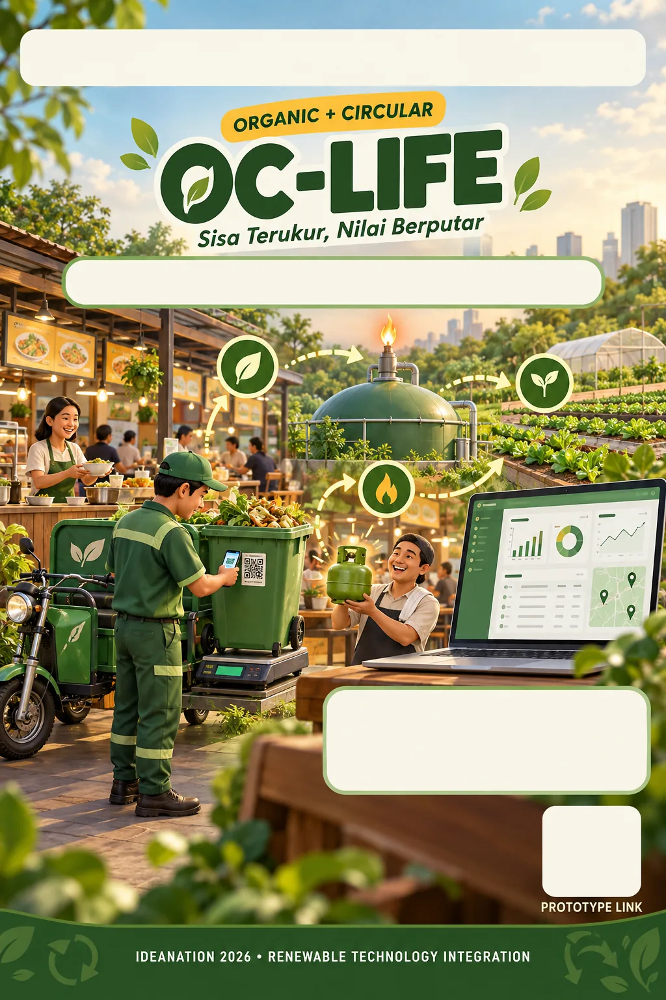

<p align="center">
  
</p>

<h3 align="center">Demo Simulasi Terpandu</h3>

<p align="center">
  Prototipe interaktif <b>OC-Life</b> untuk juri BPC IDEANATION 2026.<br>
  Satu batch sisa makanan diikuti dalam 6 langkah dan 5 peran, dan semua aksi saling terhubung.
</p>

<p align="center">
  
  
  
  
</p>

<p align="center">
  
</p>

---

## Alur tur (± 3 menit)

| # | Peran | Rute | Yang dilakukan |
| --- | --- | --- | --- |
| 1 | **Tenant** | `#/tenant` | Centang 3 poin persiapan → *Wadah siap dijemput* |
| 2 | **Petugas** | `#/petugas` | Scan QR → pilih *Warung Bu Sari* → timbang → foto → checklist → *Simpan batch* |
| 3 | **Quality gate** | otomatis | Hasil Murni / Pilah Ulang / Ditolak → *Kirim ke PDU* |
| 4 | **Operator PDU** | `#/operator` | *Terima & catat output* (biogas, bioslurry, poin cair) |
| 5 | **Tenant → Koperasi** | `#/koperasi` | Tukar 500 poin jadi e-voucher, lalu validasi. Coba cek 2× untuk melihat pencegahan klaim ganda |
| 6 | **Pengelola** | `#/pengelola` | Dashboard, *Laporan dampak* (cetak/PDF) → **Impact Ledger** (`#/ledger/:id`) |

Panel tur di kanan bawah memandu setiap langkah. Tombol **Reset demo** di sidebar mengembalikan data awal sebelum juri berikutnya mencoba.

## Fitur

- Mode **offline + sinkron**: batch tetap tercatat saat sinyal hilang
- Tombol **Urungkan** setelah menyimpan batch
- **Tolak batch** dengan alasan dan tips perbaikan untuk tenant
- E-voucher QR dengan **pencegahan klaim ganda**
- Penjualan bioslurry dan stok PDU
- **Impact Ledger** per batch dengan ekspor JSON
- Feed **Aktivitas** lintas peran

## Menjalankan

```bash
npm install
npm run dev       # http://localhost:5173
npm run build     # hasil di dist/ (SPA hash-route, siap deploy)
```

## Data & konstanta

- Data dummy deterministik: 1 SWK, 25 tenant, 30 hari. Tersimpan di `localStorage` browser.
- Konstanta bisnis ada di `src/data.ts` (`K`). Samakan dengan proposal bila ada perubahan:

| Konstanta | Nilai |
| --- | --- |
| Langganan pengelola | Rp300.000 / lokasi / bulan |
| Poin per kg batch Murni | 7,5 poin |
| Harga e-voucher LPG 3 kg | 500 poin |
| Konversi bioslurry | 1 L per 1,2 kg |
| Harga bioslurry | Rp2.000 / L |

> Jika data seed diubah, naikkan `version` di `src/data.ts` agar `localStorage` lama di browser juri ikut diperbarui.

## Struktur

```
src/
  screens/   layar per peran (Home, Tenant, Petugas, Operator, Koperasi, Manager, Ledger, Finish)
  Shell.tsx  sidebar, navigasi peran, panel tur
  store.tsx  state global + persistensi localStorage
  data.ts    seed data & konstanta bisnis
  tour.ts    langkah tur terpandu
  kit.tsx    komponen UI bersama
public/kv/   key visual, ikon, dan logo (webp)
```

## Proyek terkait

- **Company profile:** [OC-Life-Website-Company-Profile](https://github.com/Naufal-Ghani22/OC-Life-Website-Company-Profile)
